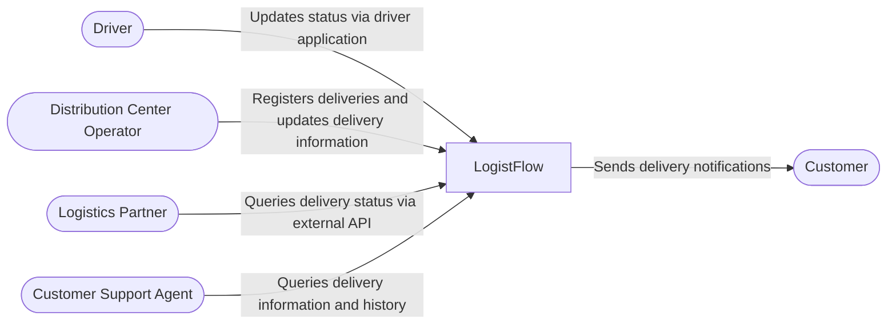
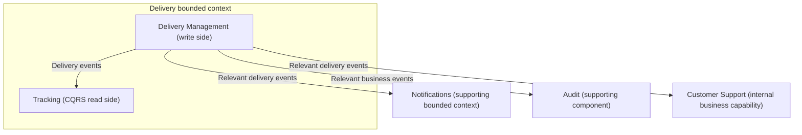
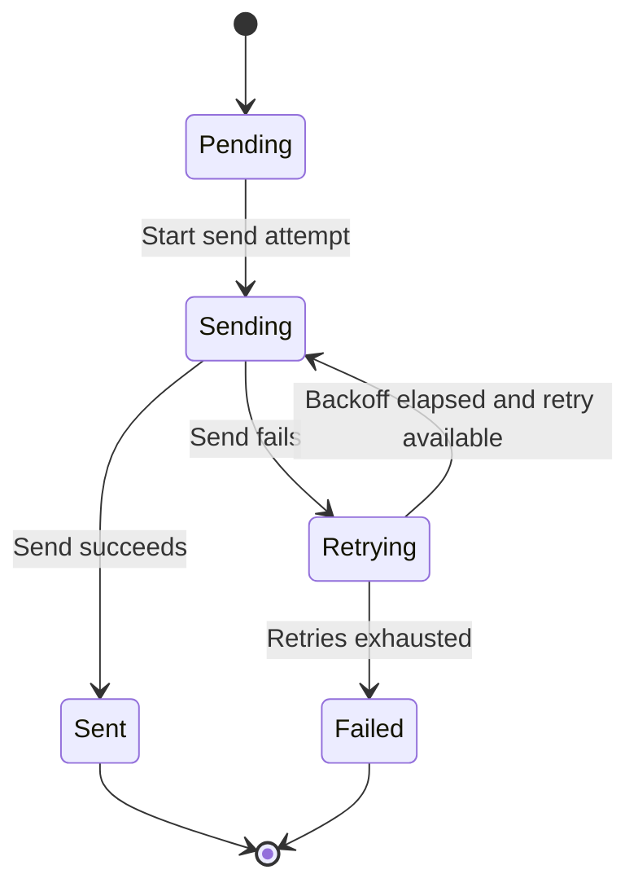
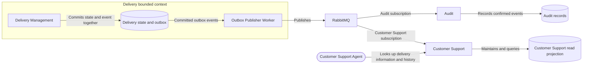
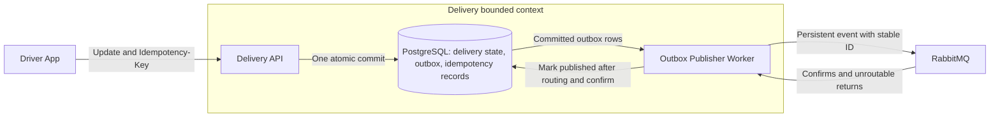
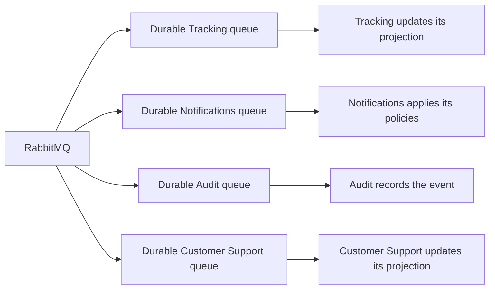
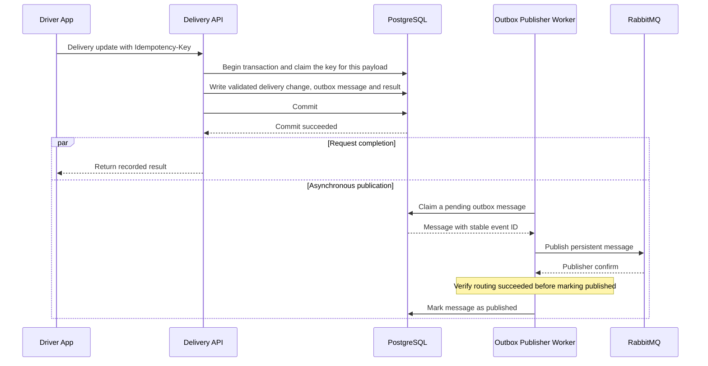
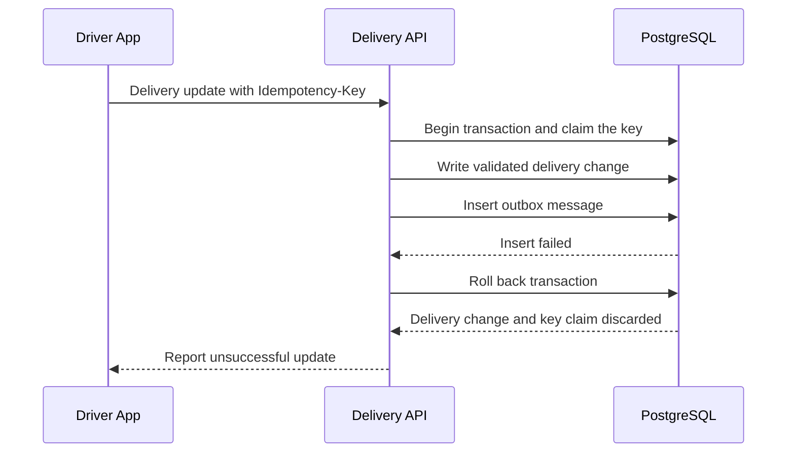
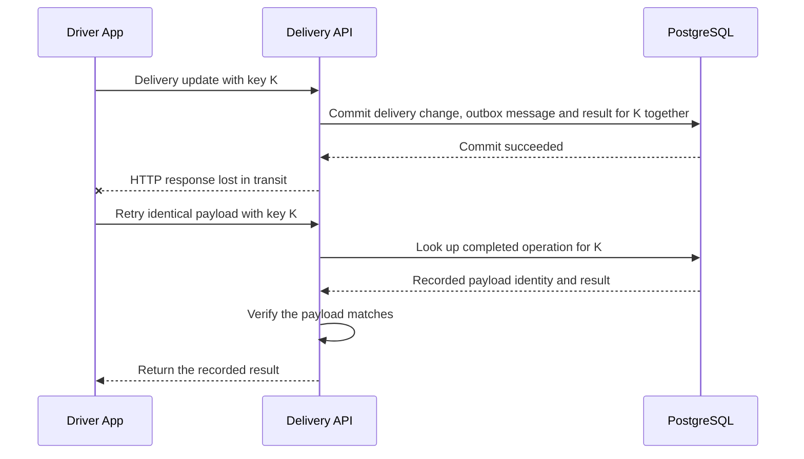

# LogistFlow Architecture

Architecture decisions are **Proposed** until reviewed. Each approved decision is marked **Approved** in its section.

## 1. System Context

LogistFlow is an event-driven logistics platform. It manages deliveries, tracks their status, notifies customers, supports customer service operations, and integrates with logistics partners.

### System boundary

LogistFlow owns the following responsibilities. External applications and systems interact with the platform through defined interfaces.

| Responsibility | What LogistFlow does |
| --- | --- |
| Delivery management | Registers deliveries and maintains delivery information. |
| Delivery tracking | Records delivery status updates and makes the current status available for queries. |
| Customer notifications | Sends delivery notifications to customers. |
| Audit records | Keeps a record of confirmed business events for later review. |
| Partner integration | Provides an external API for logistics partners to query delivery status. |
| Customer support information | Makes delivery information and delivery history available to Customer Support Agents. |

### External actors and interactions

| External actor | Interaction with LogistFlow |
| --- | --- |
| Driver | Updates delivery status through the driver application. |
| Distribution Center Operator | Registers deliveries and updates delivery information. |
| Logistics Partner | Queries delivery status through the external API. |
| Customer Support Agent | Queries delivery information and delivery history. |
| Customer | Receives delivery notifications from LogistFlow. |

### Customer Support decision

**Approved.** LogistFlow owns Customer Support as an internal business capability. Customer Support Agents are external actors who use it to look up a delivery and its history. This decision assigns business responsibility to LogistFlow and leaves room for future integration with external customer support systems.

### System context diagram

The LogistFlow box marks the system boundary. Each arrow shows who initiates the interaction.

## 2. Bounded Contexts

### Delivery and Tracking

**Approved.** Delivery is the core bounded context. Delivery Management owns the authoritative delivery state and the business rules that govern lifecycle transitions. It validates each requested transition and records the resulting state.

Tracking is initially the read side of Delivery. Under Command Query Responsibility Segregation (CQRS), Delivery Management handles changes, while Tracking answers queries. The Tracking worker consumes delivery events through RabbitMQ and updates a projection of delivery state. The Tracking API reads that projection to answer delivery status queries.

The Tracking API and worker may be deployed independently. Both remain part of the Delivery bounded context and use its definition of delivery status.

### Bounded context map

The map shows how delivery events connect the core and supporting bounded contexts to the other consumers inside LogistFlow. Each arrow represents an event subscription through RabbitMQ.

### Tracking rationale and trade-offs

The current tracking requirement is to report the state that Delivery Management has recorded. It uses the same lifecycle rules and terminology. A separate Tracking bounded context would introduce a second model and require the team to keep the two aligned, without a distinct business responsibility to justify that work.

The projection lets Tracking organize data for queries while Delivery Management retains authority over changes. The trade-off is eventual consistency. After Delivery Management accepts a status change, the Tracking API can return the previous status until the worker processes the event.

### Tracking evolution strategy

Reevaluate the boundary if Tracking develops independent business rules, terminology, or responsibilities. GPS tracking, route deviation detection, geofencing, or estimated arrival calculations could introduce concepts with their own rules. Review those requirements when they arise to determine whether Tracking warrants its own bounded context.

### Notifications

Notifications is a **supporting bounded context**. It consumes relevant delivery events and applies its own policies to decide whom to notify and which channel to use. It owns the notification record, status, send attempts, failure handling, retries, and history. These decisions can change independently of the rules for moving a delivery through its lifecycle.

The notification lifecycle below is **Proposed**. Each attempt belongs to the notification. Delivery Management owns physical delivery attempts, including failed attempts, and all transitions of the authoritative delivery state. A completed delivery stays completed even if its notification exhausts every retry.

### Audit and Customer Support

**Approved.** Audit is an independent supporting component. It records confirmed business events using the meaning established by the component that produced them. For example, when Delivery Management commits a failed delivery attempt, Audit records that outcome. Delivery Management alone decides how to handle the failure and whether to change the delivery status.

**Approved.** Customer Support is an independent consumer of delivery events. It uses Delivery's definitions of status and history to answer agents' queries. Its projection serves those queries while Delivery Management retains all authority to change a delivery.

Neither responsibility currently requires a separate bounded context. Audit preserves facts that other components have confirmed. Customer Support presents those facts for a different audience. Each needs control over its own records and processing, but neither introduces distinct business rules or a lifecycle of its own.

The classification of Partner Integration remains open for review.

## 3. Technical Components

The proposed stack includes C# on .NET 10, ASP.NET Core, RabbitMQ, PostgreSQL, Redis, and NGINX, with Docker for containers, Markdown for documentation, and Mermaid for diagrams.

### Audit and Customer Support components

The diagram follows a committed delivery event from the outbox to the records that Audit and Customer Support each own.

Audit processes its subscription independently. It commits the stable event ID and its audit record together. If RabbitMQ redelivers the same event, Audit acknowledges the copy without writing a second record.

Customer Support updates its own read projection when it consumes a relevant delivery event. It answers agents' queries from that projection, independently of Tracking and Audit.

### Operational failures

A failed physical delivery attempt is a business outcome once Delivery Management commits it. A database rollback, a publication timeout, or a consumer exception is an operational failure. Record these failures in structured logs and monitor them with the relevant failure and backlog metrics. They produce no business success event. A rollback, for example, leaves no committed delivery change for Audit to record or Customer Support to display.

### Outbox Publisher Worker

Delivery owns the independently deployable Outbox Publisher Worker. The Delivery API returns a committed update as soon as PostgreSQL commits. Publication can proceed later, even if the worker or RabbitMQ was unavailable at commit time.

1. Claim pending outbox rows in PostgreSQL. Concurrent workers must coordinate claims so that only the current claimant can mark a row as published. After a restart, pending rows and abandoned claims must become eligible for processing again.
2. Publish each event as a persistent RabbitMQ message with its original event ID. Request a publisher confirm and use mandatory publishing to detect an unroutable message. Correlate any return and confirm with their publication.
3. Mark the row as published only after a positive confirm and successful routing. RabbitMQ can confirm an unroutable publication, so a returned message stays pending even if a positive confirm follows. Mandatory publishing detects a route to at least one queue. The expected bindings for each subscribing consumer also need to be verified. [RabbitMQ publisher confirms](https://www.rabbitmq.com/docs/confirms#when-will-published-messages-be-confirmed-by-the-broker)
4. Keep unconfirmed, returned, or otherwise unsuccessful messages durable in PostgreSQL. Retry transient failures with backoff and flag routing failures for investigation. If the outcome is unknown, republish with the same event ID.

Monitor the pending message count and the age of the oldest pending message. Compare the rate of new outbox rows with the successful publication rate to see whether the backlog is growing or draining. Monitor worker health and publication failures, including returns, negative confirms, and confirm timeouts. A healthy process with an aging backlog still needs investigation.

## 4. Event-Driven Architecture

### Transactional Outbox

The Dual Write Problem arises when a delivery change commits in PostgreSQL but publication to RabbitMQ fails, or when an event is published for a change that later rolls back. Delivery Management uses the Transactional Outbox to make one PostgreSQL commit the point at which both the state change and the obligation to publish take effect.

In **one transaction**, write the validated delivery change, its outbox messages with stable event IDs, and the API idempotency record with the request identity and result when applicable. If any write fails, roll back the entire transaction. Only committed rows are eligible for publication. Publishing to RabbitMQ is a later operation owned by the worker.

### API idempotency and Driver App retries

The Driver App generates one `Idempotency-Key` per logical operation and reuses it with the same payload on every retry. This applies to connection failures, request timeouts, transient database transaction failures, and a lost HTTP response after commit. A new operation gets a new key.

| Request received by the Delivery API | Required outcome |
| --- | --- |
| First request for a key | Establish ownership of the key transactionally and apply the operation. Commit the request identity, payload identity, and response with the delivery change and its outbox messages. |
| Same key and payload after commit | Return the stored result, including its original status and response data. Skip the write and event creation. |
| Same key with a different payload | Reject the conflicting request. Preserve the recorded operation and result. |
| Concurrent requests with the same key | Serialize ownership in PostgreSQL. After the owning transaction finishes, check the committed record before executing. A matching retry can take ownership if the first transaction rolled back. |

**Recommended future enhancement.** An offline-first Driver App could keep pending operations and their keys locally across restarts. If implemented, it must show an update as awaiting synchronization until the API confirms the commit or returns the stored result. Retry transient failures with the original key. Surface permanent validation or business rule failures to the driver and stop automatic retries.

## 5. RabbitMQ Messaging Topology

### Independent consumer processing

Each logical consumer has its own durable queue bound to the delivery events it needs. For an event relevant to all four subscriptions, Tracking, Notifications, Audit, and Customer Support each receive a copy and acknowledge or retry it independently.

**Processing and acknowledgement.** Use persistent messages, manual acknowledgements, and idempotent consumers. Each consumer identifies duplicates by the stable event ID within its own subscription. Where effects are local to a database, commit the processed event ID and the business change together, protecting that pair against concurrent redelivery. A copy whose effects already committed can be acknowledged immediately. For Notifications, committing a notification and its outstanding send work can complete event processing while provider delivery is still pending.

**Retry and controlled reprocessing.** Acknowledge a message only after processing succeeds or responsibility has transferred durably. On a transient failure, retry with backoff. When handing work to a retry queue, confirm that the copy reached durable storage before acknowledging the original. On a permanent processing failure or exhausted message retries, retain the message in a durable Dead Letter Queue (DLQ) for that consumer. Monitor failures, retry volume, and dead-letter accumulation. Investigate the cause before replaying selected messages with their original IDs. Preserve successful work in the other subscriptions.

**External side effects.** A provider can accept an email or SMS just before the sender loses the response or crashes. The local transaction cannot establish whether the provider sent it. Use a stable provider idempotency key per intended send across its attempts when the provider supports one. Otherwise a retry can send a duplicate. Retain the uncertain outcome in the notification history for reconciliation.

## 6. Eventual Consistency

Delivery Management's commit establishes the authoritative status. Tracking and Customer Support may show different statuses for the same delivery while their consumers catch up. Until Customer Support processes the event, the agent's view of delivery history can also lag. Audit may have yet to record the event, and a notification can be pending or failed. Each consumer catches up independently when publication and processing resume. An exhausted notification requires review within Notifications while the delivery retains its committed status.

| Guarantee | Scope and limit |
| --- | --- |
| Message durability | A committed outbox row retains the event until successful publication. Persistent messages in durable queues protect routed work across broker restarts, subject to the survival of the underlying storage. |
| Message delivery | Publication retries and manual acknowledgements provide at-least-once delivery under recovery. Loss of a confirm or acknowledgement can cause another copy. A publisher confirm establishes broker acceptance. Consumer completion is a separate outcome. |
| Business processing | Atomic API idempotency and consumer deduplication protect their respective local state changes from repeats. End-to-end exactly-once processing cannot be guaranteed across an external provider. |

See the [RabbitMQ reliability guide](https://www.rabbitmq.com/docs/reliability).

## 7. Cache Strategy

## 8. Load Balancing and Failover

## 9. Architecture Flows

### Successful delivery update

The PostgreSQL commit makes the delivery update authoritative. The API can return the recorded result as soon as the commit succeeds. Publication proceeds independently.

### Database rollback

The delivery write in this sequence is provisional. After rollback, the publisher has no event to send for this attempt. If the failure is transient, the app can retry the original operation with the same key.

### Lost HTTP response and idempotent retry

### Failure scenarios

| # | Failure | Expected behavior and recovery |
| --- | --- | --- |
| 1 | Delivery write succeeds inside the transaction, then outbox insertion fails. | Roll back the whole transaction, including the delivery change and any idempotency record. The delivery retains its previous state. |
| 2 | The database transaction fails. | PostgreSQL discards its writes. The app can retry a transient failure with the same key. If the commit outcome is unknown to the app, the same-key retry resolves it. |
| 3 | The Delivery API crashes before commit. | PostgreSQL rolls back the open transaction when the connection closes. A retry can execute the operation with the original key. |
| 4 | The Delivery API crashes after commit. | The delivery change, outbox message, and recorded result survive the API process. Publication can proceed. An identical retry receives the saved result. |
| 5 | The HTTP response is lost after commit. | Until it receives confirmation, the app treats the operation as awaiting synchronization. Retrying with the same key and payload returns the recorded result without a second transition or outbox message. |
| 6 | The Outbox Publisher Worker is unavailable. | The API can still commit updates to PostgreSQL. Pending messages accumulate durably and the worker resumes publication after restart. |
| 7 | RabbitMQ is unavailable. | Delivery commits can continue. The publisher retains unconfirmed messages in the outbox and retries transient failures with backoff. Consumers may fall behind. |
| 8 | RabbitMQ accepts a message, then the publisher crashes before marking it published. | The outbox entry remains pending. The worker can republish it with the original event ID, so each consumer must tolerate another copy. |
| 9 | A consumer receives a duplicate message. | The consumer checks its own processing record for the event ID. If the local effect committed, it acknowledges the copy. For an uncertain external send, a retry uses provider idempotency where available. |
| 10 | Notifications fails while Tracking and Audit succeed. | Tracking and Audit keep their results and acknowledge their own deliveries. Notifications handles its failure independently. A completed delivery stays completed. |
| 11 | Notification retries are exhausted. | Under the proposed lifecycle, Notifications marks the notification as Failed, retains its attempt history, and surfaces the failure for review. Delivery Management retains the recorded delivery status. |
| 12 | The outbox backlog grows during a prolonged outage. | Monitor pending count, oldest pending age, and the rate of backlog growth. Keep pending messages durable and drain the backlog when publication resumes. Backlog limits and prolonged-outage policy remain open. |

## 10. Risks and Trade-offs

| Decision | Benefit and cost |
| --- | --- |
| Supporting Notifications context with an independent lifecycle | Recipient selection, channel policy, and send retries can evolve together. Operations must track notification outcomes separately from delivery outcomes. |
| Transactional Outbox and independent publisher | A delivery can commit throughout a broker or publisher interruption while PostgreSQL has capacity. The outbox consumes storage, the worker needs monitoring, and recovery may republish an event. |
| API and consumer idempotency | A client can recover a lost response and a consumer can recover a lost acknowledgement without repeating committed local work. Both paths need durable identifiers, stored outcomes or processing records, and concurrency control. |
| Failure isolation and eventual consistency | A slow or failing subscription leaves the others free to progress. Users can observe different stages of the same delivery update, and operators must distinguish publication lag, consumer lag, and a terminal notification failure. |

### Open decisions

- What backlog size and oldest-pending age are acceptable? What capacity limits, alert thresholds, and admission or recovery policy should apply during a prolonged outage?
- Which retry intervals and attempt limits should apply to notification sends and consumer processing? The notification lifecycle is proposed for review.
- How long must API idempotency and consumer processing records be retained to cover client retries and controlled replay?
- How should Partner Integration be classified within LogistFlow?
